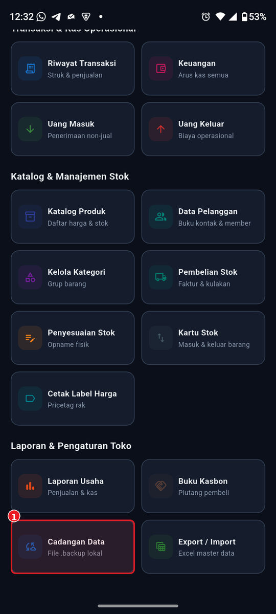
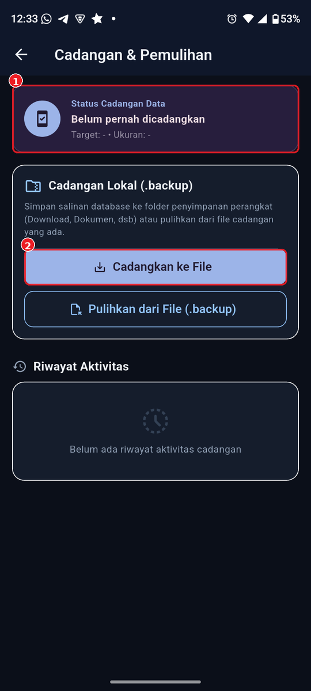
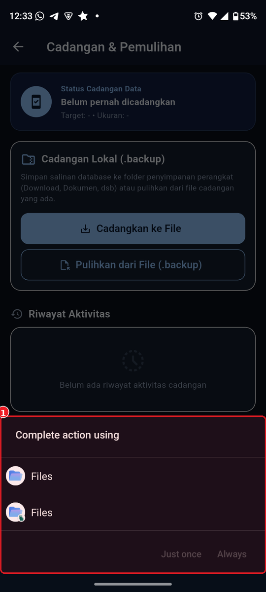

Karena **dotKasir** beroperasi secara mandiri dan *offline-first* di memori internal perangkat Android Anda tanpa ketergantungan server cloud eksternal, membuat cadangan data (*backup*) secara berkala adalah langkah terpenting untuk melindungi seluruh riwayat transaksi, master katalog produk, kasbon, dan buku kas toko.

Panduan ini membahas langkah demi langkah membuat file cadangan `.backup`, menyimpannya ke lokasi aman, dan cara memulihkan (*restore*) database saat berganti ponsel baru.

---

## 1. Mengakses Menu Cadangan Data di Beranda

Fitur pencadangan dapat dibuka langsung dari layar beranda:

1. Buka aplikasi **dotKasir**.
2. Gulir ke bawah pada seksi **Laporan & Pengaturan Toko**.
3. Ketuk kartu **[1] Cadangan Data** (ikon putaran arsip biru dengan subjudul *File .backup lokal*).

> **Keterangan Penanda:**
> - **[1] Kartu Cadangan Data**: Pintu masuk ke modul backup database lokal dan restore.

---

## 2. Membuat Cadangan Database Baru (.backup)

Pada halaman **Cadangan & Pemulihan**:

1. **[1] Status Cadangan Data**: Menampilkan informasi kapan database terakhir kali dicadangkan, nama file target, dan besaran ukuran file arsip.
2. **[2] Tombol Cadangkan ke File**:
   - Ketuk tombol ini untuk memulai proses enkapsulasi database toko menjadi sebuah file arsip tunggal berakhiran `.backup`.
   - Sistem Android akan meminta Anda memilih folder penyimpanan lokal (misalnya folder *Download*, *Documents*, atau kartu memori SD Card).
   - Setelah selesai, nama file cadangan akan tercatat pada seksi **Riwayat Aktivitas**.

> **Keterangan Penanda:**
> - **[1] Status Cadangan Data**: Ringkasan riwayat dan waktu backup terakhir.
> - **[2] Tombol Cadangkan ke File**: Membuat salinan arsip database offline.

---

## 3. Memulihkan Data Toko (Restore)

Gunakan fitur ini apabila Anda baru saja berganti smartphone kasir, menginstal ulang aplikasi, atau ingin mengembalikan kondisi data ke tanggal tertentu:

1. Ketuk tombol **Pulihkan dari File (.backup)**.
2. Pemilih berkas sistem Android (*[1] Complete action using Files*) akan terbuka.
3. Pilih aplikasi pengelola berkas (*Files*) lalu cari file `.backup` yang sebelumnya telah Anda simpan.
4. Aplikasi akan memverifikasi integritas database dan meminta konfirmasi pemulihan.
5. Setelah dikonfirmasi, seluruh katalog produk, pelanggan, invoice penjualan, dan arus kas akan kembali pulih persis seperti saat file backup dibuat.

> **Keterangan Penanda:**
> - **[1] Dialog Pemilih Berkas (Files)**: Memilih arsip `.backup` yang ingin dipulihkan ke aplikasi.

---

## 4. Tips Mengamankan File Cadangan Toko

- **Kirim ke Google Drive atau WhatsApp**: Segera setelah menekan tombol *Cadangkan ke File*, bagikan file `.backup` tersebut ke Google Drive pribadi atau kirim ke chat WhatsApp Anda sendiri (*Message to self*) agar data tetap aman meskipun HP kasir hilang atau rusak fisik.
- **Jadwal Rutin**: Biasakan mencadangkan database minimal sekali seminggu (misal setiap hari Minggu malam setelah tutup toko).
- **Label Waktu**: Nama file cadangan yang dihasilkan dotKasir menyertakan format tanggal dan jam otomatis sehingga Anda tidak akan tertukar antara file backup lama dan baru.
