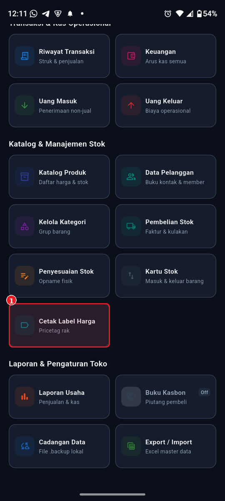
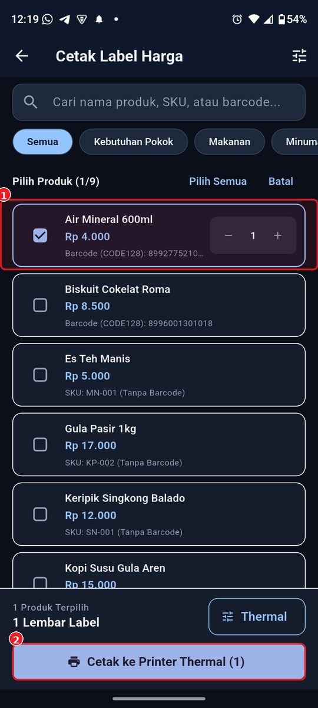
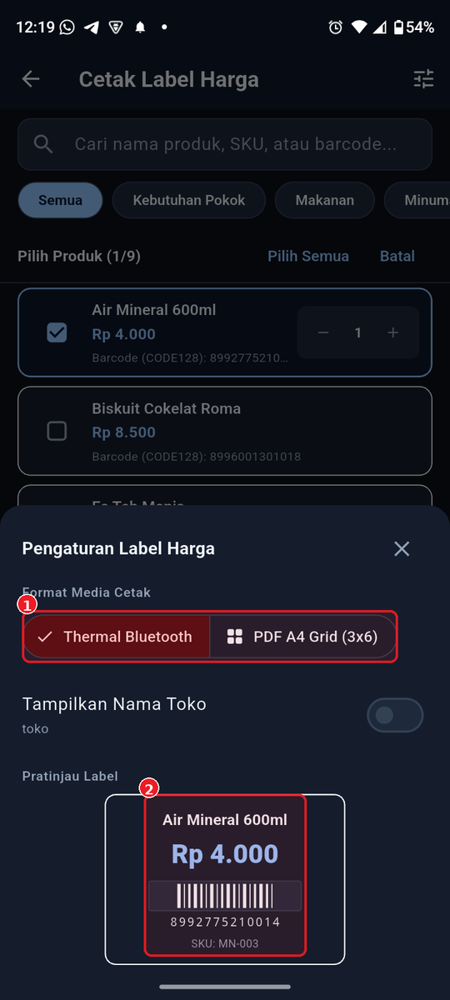

Menampilkan label harga (*pricetag*) yang jelas pada rak atau etalase toko sangat memudahkan pembeli melihat harga tanpa harus bolak-balik bertanya kepada kasir. Di **dotKasir**, Anda dapat membuat dan mencetak label harga rak dalam hitungan detik.

Fitur ini mendukung dua media cetak utama:
1. **Printer Thermal Bluetooth (58/80 mm)**: Mencetak stiker atau kertas kecil secara langsung tanpa tinta.
2. **Kertas HVS / Stiker A4 (Grid 3×6)**: Menghasilkan dokumen PDF berisi 18 label harga rapi per lembar untuk dicetak menggunakan printer komputer biasa.

---

## 1. Mengakses Menu Cetak Label Harga

Fitur label harga dapat diakses langsung dari menu utama:

1. Buka aplikasi **dotKasir**.
2. Pada layar utama, gulir ke seksi **Katalog & Manajemen Stok**.
3. Ketuk kartu **[1] Cetak Label Harga** (ikon label dengan subjudul *Pricetag rak*).

> **Keterangan Penanda:**
> - **[1] Kartu Cetak Label Harga**: Ketuk untuk membuka layar pemilihan produk dan konfigurasi cetak pricetag.

---

## 2. Memilih Produk & Menentukan Jumlah Label

Pada layar utama Cetak Label Harga, Anda dapat menyaring dan memilih barang yang ingin dicetak labelnya:

1. Gunakan bilah pencarian atau chip kategori (*Kebutuhan Pokok*, *Makanan*, *Minuman*) untuk mempercepat penemuan barang.
2. Centang kotak pilihan pada produk yang ingin dibuatkan label harga.
3. Anda dapat menaikkan jumlah lembar cetak per produk menggunakan tombol **[+]** (misalnya jika produk dipajang di 2 rak yang berbeda).
4. Di bagian bawah layar, periksa ringkasan **Produk Terpilih** dan **Lembar Label**.
5. Ketuk tombol **[2] Cetak ke Printer Thermal** untuk mulai mencetak.

> **Keterangan Penanda:**
> - **[1] Kartu Produk Terpilih**: Menampilkan centang aktif, nama produk, harga jual aktif, kode barcode (CODE128), dan tombol pengatur jumlah lembar.
> - **[2] Tombol Cetak ke Printer**: Tombol aksi utama untuk mengirim perintah cetak ke perangkat printer.

---

## 3. Mengatur Format Media & Pratinjau Label

Sebelum mencetak, Anda dapat menyesuaikan tampilan label harga sesuai kebutuhan rak toko:

1. Di pojok kanan atas bilah navigasi, ketuk ikon **Pengaturan Cetak** (ikon slider).
2. Panel bawah **Pengaturan Label Harga** akan terbuka:
   - **[1] Format Media Cetak**:
     - **Thermal Bluetooth**: Cocok untuk printer kasir mini portabel.
     - **PDF A4 Grid (3×6)**: Menghasilkan lembar PDF 18 label siap gunting untuk dicetak di kertas stiker A4.
   - **Tampilkan Nama Toko**: Aktifkan jika Anda ingin mencantumkan nama warung/toko di bagian paling atas label.
   - **[2] Pratinjau Label**: Menampilkan simulasi tampilan nyata label harga sebelum dicetak (nama produk, nominal harga berukuran besar, garis barcode yang dapat discan, dan SKU produk).

> **Keterangan Penanda:**
> - **[1] Format Media Cetak**: Pilihan antara printer struk thermal Bluetooth atau format dokumen PDF lembar A4.
> - **[2] Pratinjau Label**: Contoh visual hasil cetak yang mencantumkan nama produk, font harga tebal, barcode fisik, dan kode SKU.

---

## 4. Tips Praktis Memasang Pricetag Toko

- **Gunakan Kertas Stiker Thermal**: Untuk printer thermal Bluetooth, Anda bisa membeli gulungan kertas stiker thermal (label roll) ukuran 58 mm agar label bisa langsung ditempel di rak tanpa perekat tambahan.
- **Barcode Bisa Discan**: Barcode yang tercetak pada pricetag rak dapat langsung dibaca oleh scanner kamera di layar kasir dotKasir saat melayani pembeli.
- **Perbarui Label Saat Harga Berubah**: Begitu Anda mengedit harga jual di menu Katalog Produk, segera cetak ulang label harga barang tersebut agar harga di rak selalu cocok dengan harga di struk kasir.
