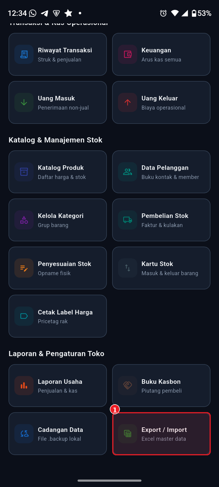
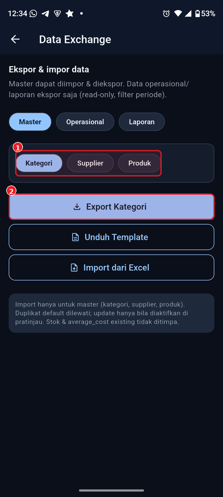
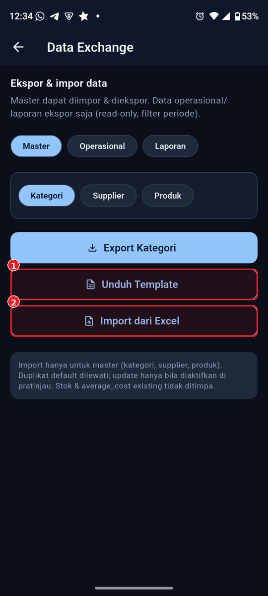

Menambahkan ratusan atau ribuan produk dagangan satu per satu lewat ponsel tentu memakan banyak waktu dan tenaga. Di **dotKasir**, Anda dapat memanfaatkan fitur **Data Exchange (Ekspor & Impor Excel)** untuk mengunggah katalog produk, master kategori, dan data supplier secara massal (*bulk import*) langsung dari komputer via file spreadsheet Excel (.xlsx).

Panduan ini membahas langkah demi langkah mengekspor data toko, mengunduh format template resmi, dan mengimpor file Excel ke aplikasi dotKasir.

---

## 1. Mengakses Menu Export / Import di Beranda

Fitur migrasi data dapat diakses langsung dari menu utama:

1. Buka aplikasi **dotKasir**.
2. Gulir ke bagian bawah pada seksi **Laporan & Pengaturan Toko**.
3. Ketuk kartu **[1] Export / Import** (ikon spreadsheet hijau dengan subjudul *Excel master data*).

> **Keterangan Penanda:**
> - **[1] Kartu Export / Import**: Pintu masuk ke modul pertukaran data (Data Exchange).

---

## 2. Mengekspor Master Data Toko ke Spreadsheet

Saat berada di layar **Data Exchange**:

1. Pastikan tab atas berada pada pilihan **Master** (untuk data kategori, supplier, dan produk). Anda juga dapat memilih *Operasional* atau *Laporan* untuk mengekspor riwayat transaksi.
2. Pilih sub-kategori master data yang ingin diunduh melalui tombol tab **[1] Kategori / Supplier / Produk**.
3. Ketuk tombol **[2] Export Kategori** (atau *Export Produk* bila tab Produk aktif).
4. Aplikasi akan membuat file `.xlsx` rapi yang langsung tersimpan di memori perangkat dan siap dibuka menggunakan Microsoft Excel, Google Sheets, atau WPS Office.

> **Keterangan Penanda:**
> - **[1] Tab Jenis Master Data**: Memilih entitas data yang akan diproses (Kategori, Supplier, atau Produk).
> - **[2] Tombol Export**: Mengunduh seluruh basis data aktif ke dalam berkas Excel.

---

## 3. Mengunduh Template & Impor Data Massal (Bulk Import)

Untuk menambahkan data baru dalam jumlah banyak tanpa takut salah format kolom:

1. Ketuk tombol **[1] Unduh Template**:
   - Sistem akan menghasilkan file spreadsheet standar berisi contoh baris pengisian yang benar (nama produk, barcode, harga jual, harga modal/HPP, stok awal, dan satuan).
   - Buka file template tersebut di komputer atau laptop untuk mempermudah pengetikan data produk.
2. Setelah seluruh data produk selesai diisi pada template, kirim file Excel tersebut ke smartphone Anda.
3. Ketuk tombol **[2] Import dari Excel**:
   - Pilih berkas `.xlsx` yang telah Anda isi.
   - Layar pratinjau (*preview*) akan menampilkan jumlah baris yang valid, produk baru yang akan ditambahkan, dan peringatan jika ada data yang bentrok.
   - Konfirmasi proses impor. Ribuan produk akan masuk ke katalog toko Anda dalam hitungan detik!

> **Keterangan Penanda:**
> - **[1] Unduh Template**: Mengunduh file acuan standar kolom Excel yang kompatibel dengan dotKasir.
> - **[2] Import dari Excel**: Membaca dan memasukkan baris data dari spreadsheet ke aplikasi.

---

## 4. Aturan Penting Keamanan Data Saat Impor

- **Pencegahan Duplikat**: Secara default, produk dengan barcode atau SKU yang sudah ada di katalog toko akan dilewati (*skipped*) agar tidak menimpa harga tanpa sengaja.
- **Perlindungan Riwayat Stok**: Proses impor master produk baru tidak akan merusak atau menimpa saldo stok aktual maupun nilai *average cost* yang sedang berjalan pada produk lama.
- **Format Teks Barcode**: Pastikan kolom barcode di Excel diatur ke format *Text* (bukan *Scientific Notation/Angka E*) agar angka barcode panjang (seperti EAN-13) tidak terpotong menjadi format pecahan.
