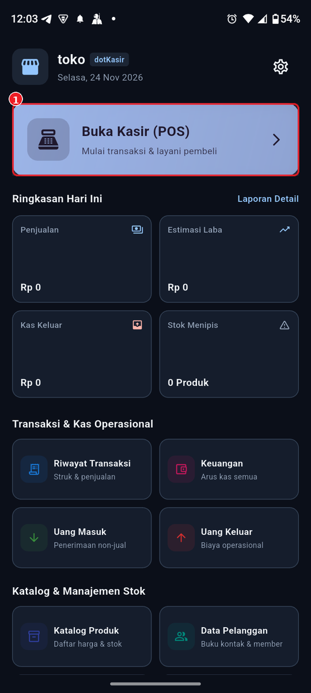
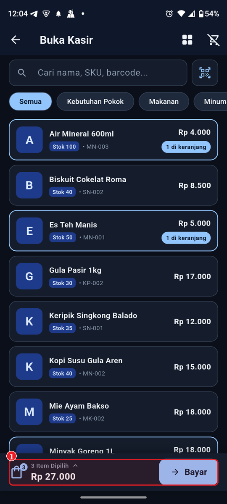
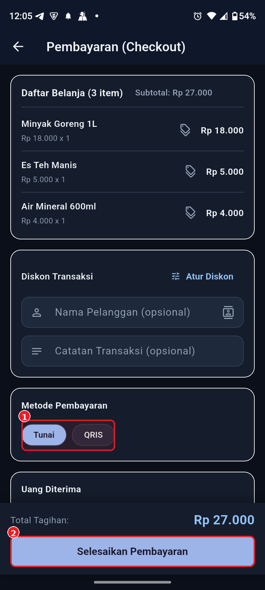
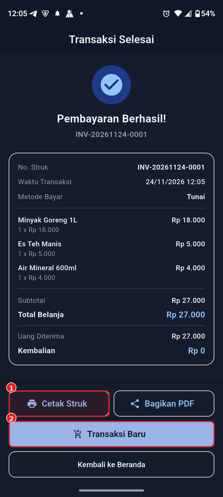
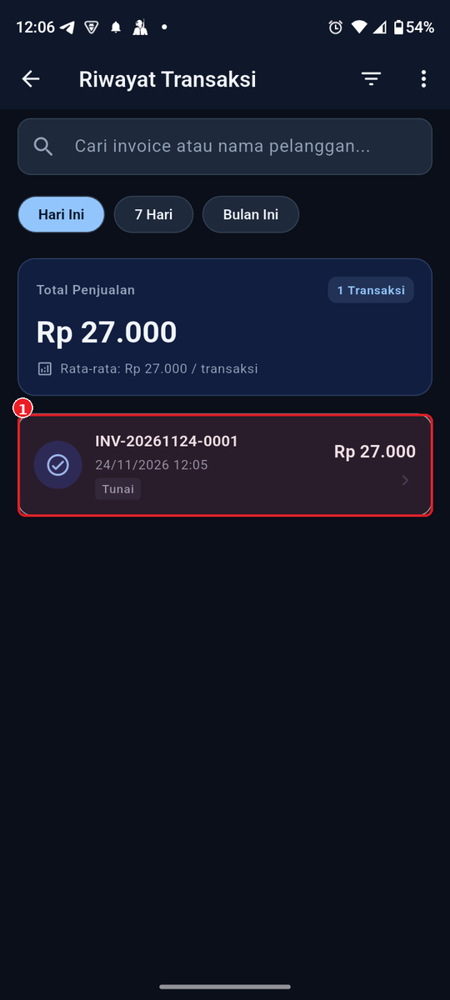
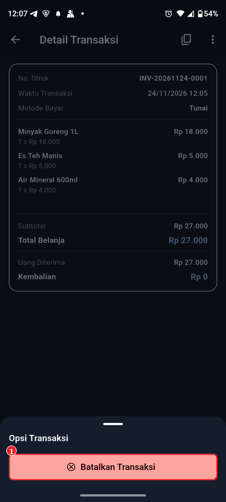

Layar Kasir (*Point of Sale / POS*) adalah fitur yang paling sering digunakan setiap hari oleh pemilik toko dan kasir di **dotKasir**. Alur transaksi dirancang sangat cepat, tombol berukuran besar dan nyaman ditekan, mendukung scanner kamera HP, perhitungan kembalian otomatis, pembayaran QRIS statis, hingga pencetakan struk belanja via Bluetooth thermal.

Panduan ini membahas alur operasional kasir dari awal memilih barang hingga struk tercetak ke pelanggan.

---

## 1. Membuka Layar Kasir dari Layar Utama

Untuk mulai melayani pembeli di kasir:

1. Buka aplikasi **dotKasir**.
2. Pada bagian atas layar utama, Anda akan melihat kartu sorotan besar berwarna biru bertuliskan **Buka Kasir (POS)**.
3. Ketuk kartu **[1] Buka Kasir (POS)** untuk langsung masuk ke mode kasir aktif.

> **Keterangan Penanda:**
> - **[1] Kartu Buka Kasir (POS)**: Tombol pintas utama untuk membuka mesin kasir penjualan.

---

## 2. Memilih Produk & Mengatur Keranjang Belanja

Saat layar kasir terbuka, seluruh produk yang siap dijual akan ditampilkan:

> **Cara Memasukkan Barang ke Keranjang:**
> - **Sentuh Produk**: Cukup ketuk kartu produk yang dibeli pelanggan (misal: *Air Mineral 600ml*). Setiap sentuhan otomatis menambah kuantitas barang sebanyak 1 buah.
> - **Pindai Barcode Kamera**: Ketuk ikon kamera di kolom pencarian untuk memindai kemasan barang langsung.
> - **Filter Kategori**: Sentuh chip kategori (*Minuman*, *Makanan*, dll.) di bawah kolom pencarian untuk menyaring pilihan barang.
> - **[1] Bilah Keranjang Belanja (Bawah)**: Menampilkan ringkasan total belanja (misal: *1 Item · Total Rp 4.000*) dan tombol **Bayar**.

Ketuk tombol **[1] Bayar** untuk melanjutkan ke proses pembayaran.

---

## 3. Memproses Pembayaran (Checkout)

Pada layar pembayaran, Anda dapat menentukan diskon transaksi serta metode pembayaran yang digunakan pembeli:

> **Keterangan Penanda:**
> - **[1] Pilihan Metode Bayar**:
>   - **Tunai (Cash)**: Metode default. Dilengkapi nominal otomatis (uang pas) atau input uang tunai diterima untuk menghitung kembalian.
>   - **QRIS**: Menampilkan gambar kode QRIS statis toko Anda di layar agar pelanggan dapat langsung memindai melalui e-wallet / mobile banking.
> - **Diskon Transaksi & Pelanggan**: Opsi memberikan potongan harga atau menghubungkan transaksi ke kontak member.
> - **[2] Tombol Selesaikan Pembayaran**: Ketuk untuk memproses transaksi dan mencatat penjualan ke database toko.

---

## 4. Layar Sukses, Cetak Struk Bluetooth & Share PDF

Setelah pembayaran dikonfirmasi, layar **Pembayaran Berhasil** akan langsung muncul menampilkan total pembayaran, uang diterima, dan nominal kembalian pembeli.

> **Opsi yang Tersedia:**
> - **[1] Tombol Cetak Struk**: Mencetak nota belanja ke printer thermal Bluetooth portabel (ukuran kertas 58 mm atau 80 mm). Printer langsung mencetak tanpa memerlukan koneksi internet.
> - **Bagikan PDF**: Menghasilkan struk transaksi berformat PDF yang rapi untuk langsung dibagikan ke WhatsApp pelanggan atau disimpan ke Google Drive.
> - **[2] Tombol Transaksi Baru**: Ketuk untuk mengosongkan keranjang dan kembali ke layar kasir untuk melayani pembeli berikutnya.
> - **Kembali ke Beranda**: Keluar dari kasir dan kembali ke dashboard utama toko.

---

## 5. Melihat Riwayat Transaksi & Mencetak Ulang Struk

Seluruh penjualan yang pernah terjadi dicatat rapi dan dapat dibuka kembali kapan saja:

1. Di layar utama, buka menu **Riwayat Transaksi**.
2. Anda dapat melihat daftar nota belanja berdasarkan tanggal (*Hari Ini*, *7 Hari Terakhir*, *Bulan Ini*, atau *Rentang Tanggal Khusus*).
3. Ketuk salah satu faktur transaksi untuk membuka rincian lengkapnya.

> **Keterangan Penanda:**
> - **[1] Faktur Transaksi Penjualan**: Menampilkan nomor invoice, waktu transaksi, metode bayar, dan total penjualan.

---

## 6. Detail Transaksi & Membatalkan (Void) Transaksi

Jika pembeli meminta cetak ulang struk atau ada kesalahan input kasir yang perlu dibatalkan:

> **Keterangan Penanda:**
> - **Cetak Ulang Struk**: Cetak ulang nota thermal kapan saja.
> - **Bagikan Ulang PDF**: Kirimkan ulang salinan nota PDF ke pelanggan.
> - **[1] Batalkan Transaksi (Void)**: Jika transaksi salah input, ketuk tombol batalkan. Sistem akan membatalkan penjualan tersebut, mengembalikan stok barang fisik secara otomatis ke katalog, dan menyesuaikan buku arus kas toko Anda.
