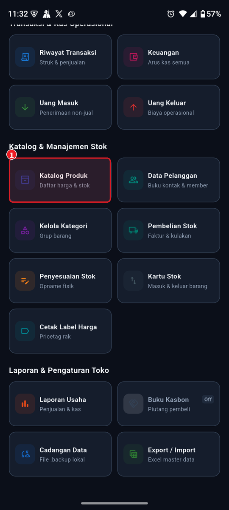
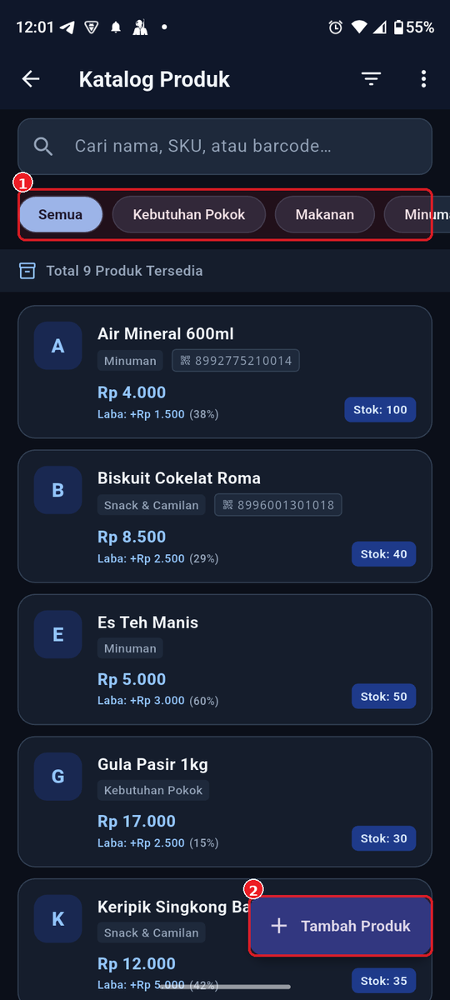
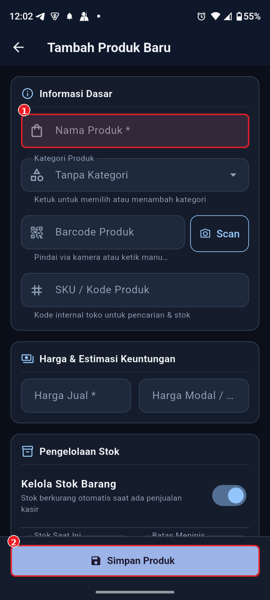
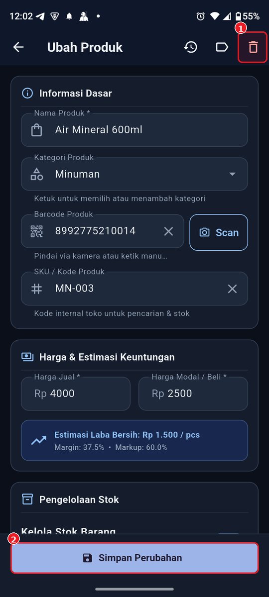

Katalog produk adalah pusat seluruh data barang dagangan Anda di **dotKasir**. Di sinilah Anda mendaftarkan nama produk, harga modal (kulakan), harga jual eceran, barcode untuk scan cepat di kasir, serta kuantitas stok barang fisik di toko.

Panduan ini membahas langkah demi langkah mengelola produk dari awal hingga tuntas.

---

## 1. Cara Mengakses Menu Katalog Produk

Untuk membuka master data barang:

1. Buka aplikasi **dotKasir** di perangkat Android Anda.
2. Pada layar utama (*Home*), gulir ke seksi **Katalog & Manajemen Stok**.
3. Ketuk kartu **[1] Katalog Produk** (dengan ikon kotak kardus dan subjudul *Daftar harga & stok*).

> **Keterangan Penanda:**
> - **[1] Kartu Katalog Produk**: Ketuk untuk membuka daftar seluruh barang, harga, dan sisa stok fisik.

---

## 2. Memahami Informasi di Layar Katalog Produk

Saat halaman Katalog Produk terbuka, Anda dapat melihat informasi lengkap dari setiap barang dagangan:

> **Elemen-Elemen Penting pada Layar Ini:**
> - **[1] Bilah Pencarian & Chip Kategori**:
>   - Ketik nama produk, barcode, atau SKU pada kolom pencarian untuk menemukan barang secara cepat.
>   - Ketuk chip kategori (`Semua`, `Kebutuhan Pokok`, `Makanan`, `Minuman`) untuk menyaring barang per kelompok dalam satu sentuhan.
> - **Kartu Produk**:
>   - Nama barang dan lencana kategori.
>   - Barcode fisik produk (misal: `8992775210014`).
>   - Harga jual dan estimasi laba nominal/persentase (misal: *Rp 4.000, Laba: +Rp 1.500 (38%)*).
>   - Lencana stok berwarna biru (misal: *Stok: 100*), oranye jika *Stok Menipis*, atau merah jika *Stok Habis*.
> - **[2] Tombol + Tambah Produk**: Tombol biru di pojok kanan bawah untuk mendaftarkan barang baru.

---

## 3. Menambahkan Produk Baru

Untuk mendaftarkan produk baru ke toko Anda:

1. Di layar Katalog Produk, ketuk tombol **[2] + Tambah Produk**.
2. Formulir pendaftaran produk baru akan terbuka:

> **Keterangan Penanda:**
> - **[1] Kolom Nama Produk \***: Masukkan nama lengkap produk (kolom wajib).
> - **[2] Tombol Simpan Produk**: Tekan untuk menyimpan data barang ke memori perangkat.

### Panduan Mengisi Kolom Formulir:

#### A. Informasi Dasar
- **Nama Produk \*** *(Wajib)*: Masukkan nama lengkap produk (contoh: `Air Mineral 600ml` atau `Biskuit Cokelat Roma`).
- **Kategori Produk**: Pilih kelompok kategori barang yang sesuai (misal: `Minuman`), atau biarkan *Tanpa Kategori*.
- **Barcode Produk**: Anda dapat mengetik angka barcode manual, atau ketuk tombol **Scan** untuk memindai langsung barcode pada kemasan menggunakan kamera ponsel.
- **SKU / Kode Produk**: Kode internal toko (opsional, dapat dikosongkan jika tidak memakai SKU).

#### B. Harga & Estimasi Keuntungan
- **Harga Jual \*** *(Wajib)*: Masukkan harga yang dibayar oleh pembeli di kasir (contoh: `4000`).
- **Harga Modal / Beli**: Masukkan harga kulakan per satuan barang (contoh: `2500`). Aplikasi akan otomatis menghitung estimasi keuntungan bersih per produk.

#### C. Pengelolaan Stok
- **Kelola Stok Barang**: Aktifkan sakelar switch ini jika produk memiliki fisik yang perlu dihitung stoknya.
- **Stok Saat Ini**: Masukkan jumlah fisik barang yang ada di rak atau gudang saat ini (contoh: `100`).
- **Batas Menipis**: Batas jumlah barang di mana aplikasi akan memberi peringatan stok menipis (contoh: `10`).

3. Setelah data terisi lengkap, ketuk tombol **[2] Simpan Produk** di bagian bawah layar.

---

## 4. Mengubah Data & Harga Produk

Jika harga kulakan berubah atau Anda ingin menyesuaikan harga jual eceran:

1. Pada layar **Katalog Produk**, ketuk kartu barang yang ingin diedit.
2. Formulir ubah produk akan terbuka dengan seluruh data yang sudah ada sebelumnya.
3. Ubah harga jual, harga modal, atau nama barang sesuai kebutuhan.
4. Ketuk tombol **[2] Simpan Perubahan** di bagian bawah layar.

> **Keterangan Penanda:**
> - **[1] Ikon Tempat Sampah**: Tombol untuk menghapus produk dari katalog toko.
> - **[2] Tombol Simpan Perubahan**: Menyimpan revisi harga atau stok barang.

---

## 5. Menghapus Produk dari Katalog

Jika suatu barang sudah tidak lagi dijual di toko Anda:

1. Buka produk yang ingin dihapus dari daftar katalog.
2. Di pojok kanan atas bilah judul, ketuk **[1] Ikon Tempat Sampah**.
3. Kotak dialog konfirmasi akan muncul. Ketuk **Ya, Hapus**.

> [!WARNING]
> Menghapus produk akan menghilangkannya dari daftar kasir. Namun, seluruh riwayat transaksi penjualan masa lalu yang pernah memuat produk ini **tetap tersimpan aman** di laporan pembukuan toko.

---

## 6. Tips Pintar Mengelola Produk di dotKasir

1. **Scan Barcode Cepat**: Memasukkan barcode pada kemasan produk sangat disarankan. Saat melayani pembeli di kasir, Anda cukup mengarahkan kamera ke barcode barang tanpa perlu mencari nama produk manual.
2. **Hard Block Stok Habis**: Jika opsi *Kelola Stok Barang* aktif, kasir tidak dapat menjual barang yang stoknya 0. Ini mencegah barang fisik terjual minus.
3. **Produk Tanpa Stok**: Untuk barang seperti jasa titip, pulsa, atau es batu yang stoknya tidak dihitung fisik, matikan sakelar *Kelola Stok Barang*. Produk tetap dapat dijual tanpa batasan kuantitas.
