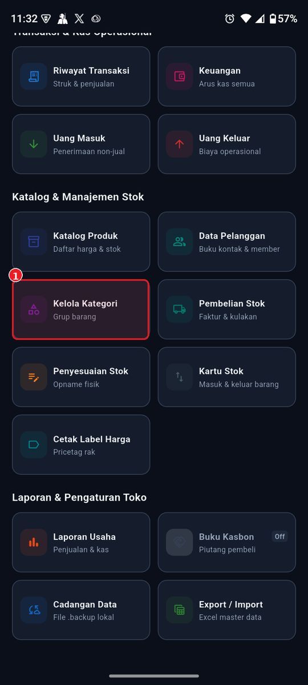
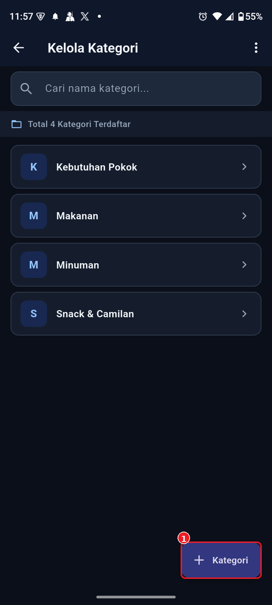
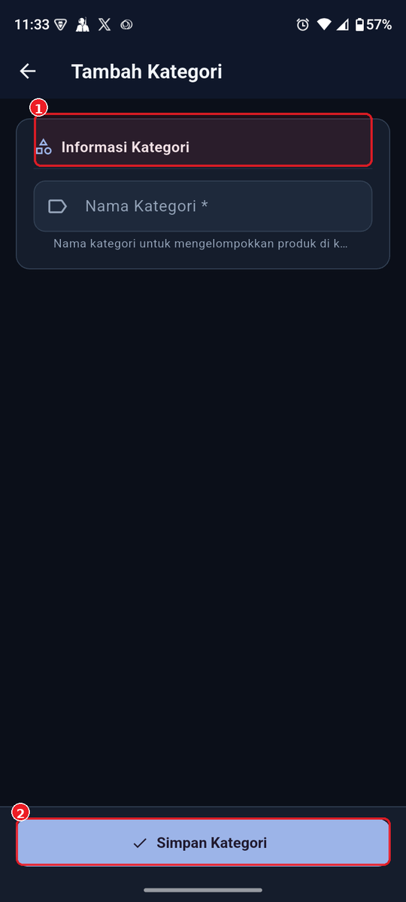
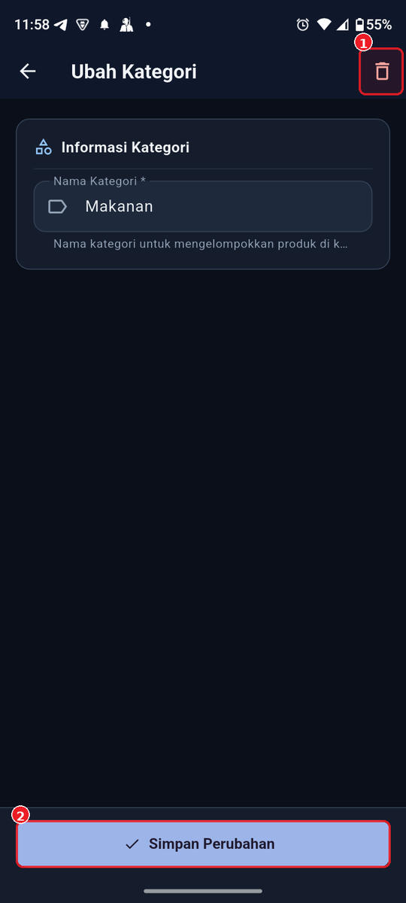

Mengatur kategori produk adalah langkah awal yang sangat penting saat mengelola toko dengan **dotKasir**. Dengan kategori yang rapi (seperti *Sembako*, *Makanan*, *Minuman*, atau *Kebutuhan Rumah Tangga*), kasir dapat memfilter dan menemukan produk dalam hitungan detik di layar kasir (*POS*).

Panduan ini membahas seluruh alur pengelolaan kategori di dotKasir secara lengkap dan berurutan.

---

## 1. Cara Mengakses Menu Kelola Kategori

Seluruh data kelompok barang dapat diakses langsung dari Layar Utama (*Home Dashboard*) aplikasi dotKasir:

1. Buka aplikasi **dotKasir** di perangkat Android Anda.
2. Pada layar utama, gulir ke seksi **Katalog & Manajemen Stok**.
3. Di dalam kisi menu, ketuk kartu **Kelola Kategori** (ikon kategori dengan subjudul *Grup barang*).

> **Keterangan Penanda:**
> - **[1] Kartu Kelola Kategori**: Ketuk kartu ini untuk masuk ke halaman daftar kategori.

---

## 2. Memahami Layar Daftar Kategori

Setelah menu dibuka, Anda akan melihat seluruh kategori yang telah terdaftar di toko Anda beserta jumlah total kategori aktif.

> **Fitur yang Tersedia di Layar Ini:**
> - **Bilah Pencarian**: Di bagian atas untuk mencari nama kategori tertentu secara instan.
> - **Menu Titik Tiga (Opsi Data)**: Di pojok kanan atas untuk mengekspor atau mengimpor daftar kategori via Excel.
> - **Daftar Kategori**: Menampilkan inisial huruf, nama kategori, dan tombol panah untuk mengedit.
> - **[1] Tombol + Kategori**: Tombol melayang di pojok kanan bawah untuk menambah kategori baru.

---

## 3. Menambahkan Kategori Baru

Untuk mendaftarkan kelompok produk baru ke dalam aplikasi:

1. Di layar daftar kategori, ketuk tombol **[1] + Kategori** di pojok kanan bawah.
2. Layar formulir **Tambah Kategori** akan terbuka.
3. Ketik nama kategori yang Anda inginkan pada kolom **[1] Nama Kategori \*** (misalnya: `Kebutuhan Pokok` atau `Snack & Camilan`).
4. Ketuk tombol **[2] Simpan Kategori** di bagian bawah layar.

> **Keterangan Penanda:**
> - **[1] Kolom Nama Kategori**: Masukkan nama kelompok barang (nama bersifat unik).
> - **[2] Tombol Simpan Kategori**: Tekan untuk menyimpan data kategori ke memori offline perangkat.

Aplikasi akan menampilkan notifikasi sukses hijau dan kategori baru langsung muncul di daftar siap digunakan.

---

## 4. Mengubah Nama Kategori

Jika ada kesalahan ketik (*typo*) atau Anda ingin memperbarui nama kelompok barang:

1. Pada daftar kategori, ketuk nama kategori yang ingin diubah.
2. Layar formulir **Ubah Kategori** akan terbuka dengan nama kategori yang sedang aktif.
3. Ubah nama kategori pada kolom input teks.
4. Ketuk tombol **[2] Simpan Perubahan** di bagian bawah.

> **Keterangan Penanda:**
> - **[1] Ikon Tempat Sampah**: Tombol untuk menghapus kategori yang sedang dibuka.
> - **[2] Tombol Simpan Perubahan**: Tekan untuk menyimpan pembaruan nama kategori.

> [!NOTE]
> **Sinkronisasi Otomatis**: Mengubah nama kategori secara otomatis memperbarui seluruh produk yang terhubung ke kategori tersebut. Anda tidak perlu mengedit produk satu per satu.

---

## 5. Menghapus Kategori Produk

Jika suatu kelompok barang sudah tidak lagi digunakan:

1. Buka kategori yang ingin dihapus dari daftar.
2. Di bilah atas (*app bar*), ketuk **[1] Ikon Tempat Sampah**.
3. Kotak dialog konfirmasi akan muncul menanyakan kepastian penghapusan.
4. Ketuk **Ya, Hapus** untuk mengonfirmasi.

> [!IMPORTANT]
> **Produk Anda Tetap Aman (Tidak Terhapus)**  
> Menghapus kategori **TIDAK AKAN** menghapus produk-produk di dalamnya. Semua barang dagangan yang sebelumnya terdaftar di kategori tersebut hanya akan berpindah status menjadi **"Tanpa Kategori"** dan tetap bisa dijual secara normal di kasir.

---

## 6. Tips Praktis untuk Pemilik Warung & Toko

- **Gunakan Nama Singkat (1–2 Kata)**: Nama kategori seperti `Minuman`, `Snack`, atau `Rokok` akan tampil lebih rapi sebagai tombol chip filter di layar kasir dibandingkan nama yang terlalu panjang.
- **Pencarian Cepat**: Jika toko Anda memiliki puluhan kategori, cukup ketik 2–3 huruf awal di kolom pencarian atas untuk langsung menyaring daftar secara *real-time*.
- **Offline Penuh**: Seluruh data kategori tersimpan di SQLite lokal perangkat Anda, dapat diakses dan diubah kapan saja tanpa membutuhkan koneksi internet.
