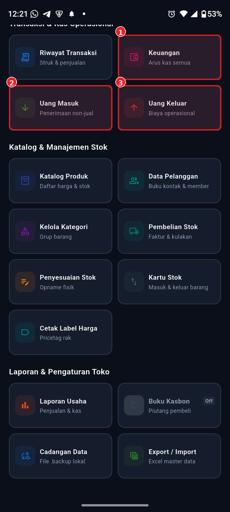
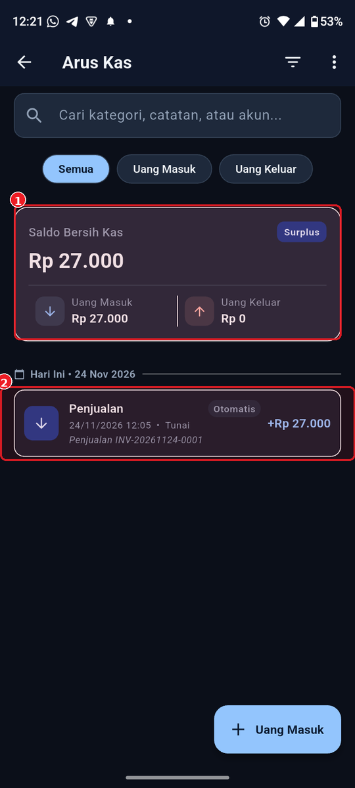
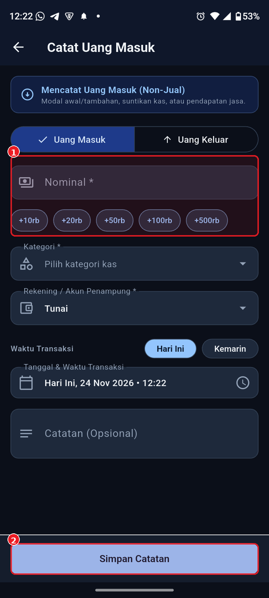
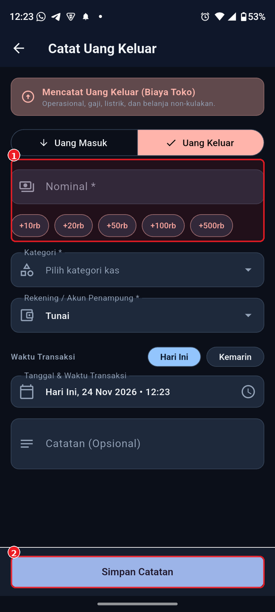

Mengelola arus kas (*cash flow*) harian dengan tertib adalah kunci agar bisnis toko tidak mengalami kebocoran dana. Di **dotKasir**, setiap transaksi kasir tercatat secara otomatis ke dalam buku kas, sementara transaksi non-penjualan—seperti modal awal toko, biaya listrik, atau gaji harian—dapat dicatat dengan sangat mudah lewat modul **Keuangan & Kas**.

Panduan ini membahas langkah demi langkah memantau saldo kas, mencatat uang masuk non-jual, dan membukukan pengeluaran toko.

---

## 1. Memahami Menu Keuangan di Layar Utama

Pada bagian atas beranda **dotKasir**, terdapat seksi **Transaksi & Kas Operasional** yang memuat tiga tombol utama pengelolaan kas:

1. **[1] Keuangan**: Membuka buku besar arus kas lengkap (penerimaan, pengeluaran, saldo bersih, dan filter waktu).
2. **[2] Uang Masuk**: Pintasan cepat untuk mencatat dana masuk non-penjualan (seperti suntikan modal atau pendapatan jasa).
3. **[3] Uang Keluar**: Pintasan cepat untuk mencatat pengeluaran biaya toko (seperti listrik, kantong kresek, atau transport).

> **Keterangan Penanda:**
> - **[1] Kartu Keuangan**: Pintu masuk ke layar Arus Kas komprehensif.
> - **[2] Kartu Uang Masuk**: Akses langsung ke formulir penerimaan kas non-jual.
> - **[3] Kartu Uang Keluar**: Akses langsung ke formulir pengeluaran operasional.

---

## 2. Memantau Arus Kas & Saldo Bersih

Saat mengetuk kartu **Keuangan**, Anda akan masuk ke layar **Arus Kas**:

1. **[1] Banner Saldo Bersih Kas**: Menampilkan akumulasi kas bersih secara *real-time* (Uang Masuk dikurangi Uang Keluar). Status **Surplus** atau **Defisit** akan ditampilkan secara otomatis.
2. **[2] Daftar Riwayat Transaksi Kas**: Menampilkan setiap arus kas masuk dan keluar secara kronologis. Transaksi dari penjualan kasir ditandai dengan badge khusus **Otomatis** beserta nomor invoice aslinya.
3. Anda dapat memfilter catatan kas menggunakan tab **Semua**, **Uang Masuk**, atau **Uang Keluar** pada bagian atas layar.

> **Keterangan Penanda:**
> - **[1] Saldo Bersih Kas**: Ringkasan total uang masuk, total uang keluar, dan saldo kas aktual saat ini.
> - **[2] Catatan Arus Transaksi**: Baris entri kas harian lengkap dengan sumber dana, metode pembayaran, dan waktu kejadian.

---

## 3. Mencatat Uang Masuk (Non-Penjualan)

Gunakan fitur ini apabila kas toko bertambah bukan dari transaksi belanja produk di kasir (misalnya: modal awal kembalian, setoran pemilik, atau jasa servis):

1. Ketuk kartu **Uang Masuk** dari menu utama, atau tekan tombol **+ Uang Masuk** di kanan bawah layar Arus Kas.
2. Masukkan jumlah nominal kas pada kolom **[1] Nominal \***. Anda juga dapat menggunakan tombol cepat nominal seperti **+10rb**, **+20rb**, **+50rb**, **+100rb**, atau **+500rb**.
3. Pilih kategori pemasukan dan akun penampung dana (misal: *Tunai* atau rekening toko).
4. Tentukan tanggal transaksi (secara bawaan terisi hari dan jam saat ini).
5. Tambahkan catatan opsional jika diperlukan keterangan tambahan.
6. Ketuk tombol **[2] Simpan Catatan** di bagian bawah layar. Saldo kas toko akan langsung bertambah seketika.

> **Keterangan Penanda:**
> - **[1] Kolom Nominal & Tombol Cepat**: Area input jumlah uang yang diterima toko.
> - **[2] Simpan Catatan**: Tombol konfirmasi penyimpanan entri uang masuk ke buku kas.

---

## 4. Mencatat Uang Keluar (Biaya Operasional)

Gunakan formulir ini setiap kali ada uang toko yang dikeluarkan untuk kebutuhan operasional selain kulakan barang (misalnya: token listrik, pulsa kuota kasir, konsumsi, atau biaya kebersihan):

1. Ketuk kartu **Uang Keluar** pada layar beranda (atau ganti tab ke *Uang Keluar* pada formulir kas).
2. Isi jumlah pengeluaran pada kolom **[1] Nominal \***. Manfaatkan tombol nominal cepat untuk mempercepat pengisian.
3. Pilih kategori biaya (misal: *Listrik & Air*, *Operasional*, *Gaji*, dsb).
4. Pastikan rekening penampung kas sesuai dengan sumber dana yang diambil (default: *Tunai*).
5. Tambahkan rincian pengeluaran pada kolom **Catatan (Opsional)** agar mudah diaudit di kemudian hari.
6. Ketuk **[2] Simpan Catatan**. Saldo kas bersih toko akan otomatis berkurang sesuai nominal yang dicatat.

> **Keterangan Penanda:**
> - **[1] Kolom Nominal Biaya**: Input nominal uang yang dibelanjakan atau dikeluarkan dari laci kas.
> - **[2] Simpan Catatan**: Menyimpan pencatatan pengeluaran ke dalam sistem keuangan toko.

---

## 5. Tips Disiplin Pengelolaan Kas

- **Modal Kembalian Pagi**: Selalu catat modal awal kasir setiap pagi dengan fitur **Uang Masuk** berlabel kategori *Modal Awal*.
- **Setoran Akhir Shift**: Bila uang hasil penjualan disetor ke rekening bank pribadi di malam hari, catat pengeluaran tersebut melalui **Uang Keluar** agar sisa saldo laci kas di aplikasi tetap cocok dengan uang fisik.
- **Audit Rutin**: Cocokkan saldo fisik di laci kas dengan angka pada banner **Saldo Bersih Kas** sebelum toko tutup setiap harinya.
