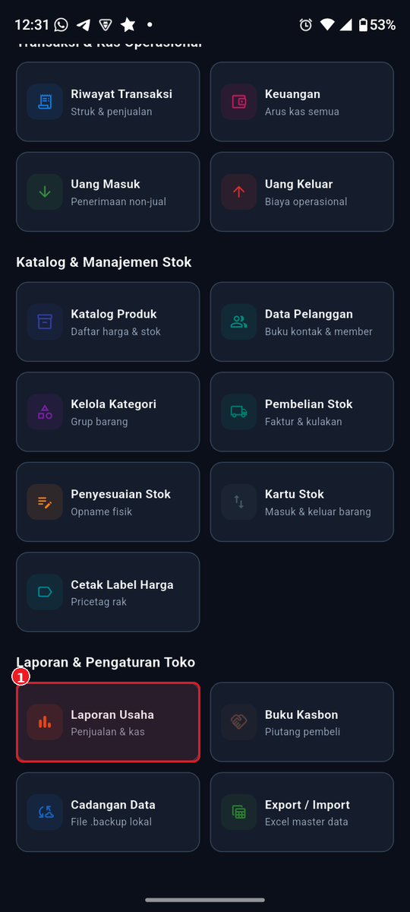
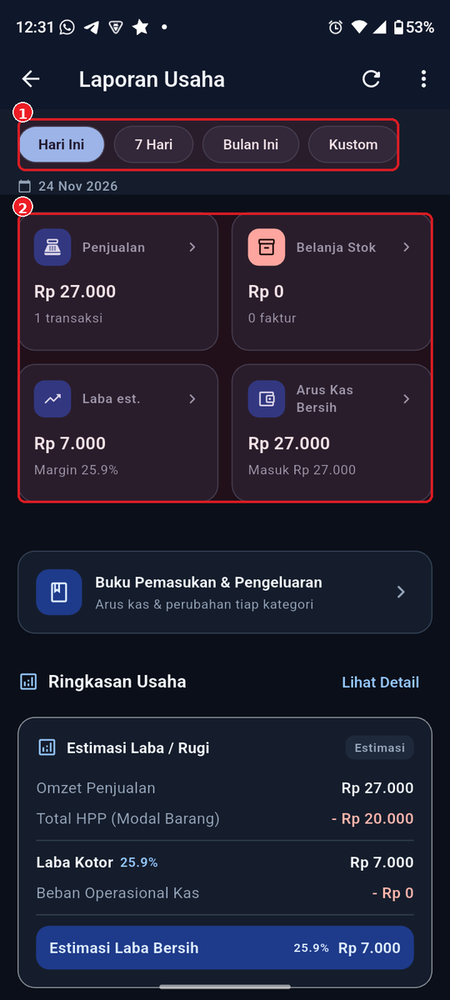
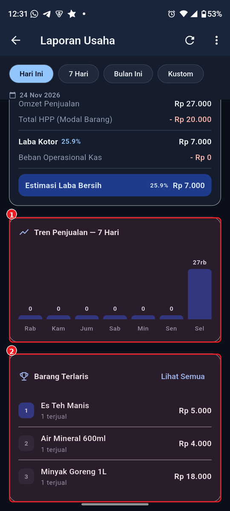
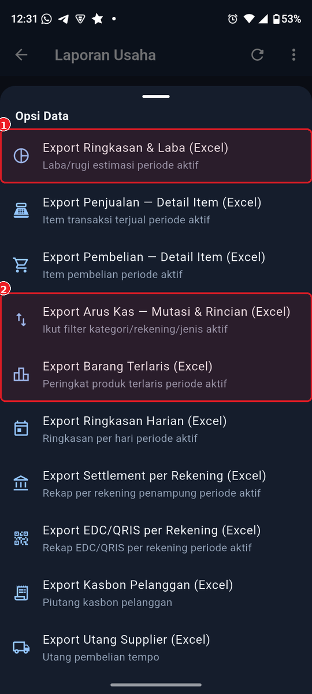

Mengetahui kesehatan finansial dan pertumbuhan bisnis toko tidak perlu rumit atau menunggu pembukuan akhir bulan. Modul **Laporan Usaha** di **dotKasir** menghitung omzet penjualan, estimasi laba bersih, beban operasional, grafik tren mingguan, hingga peringkat produk terlaris secara otomatis setiap kali kasir menyelesaikan transaksi.

Panduan ini membahas cara membaca metrik laba rugi, menganalisis produk terlaris, dan mengekspor laporan komprehensif ke format Microsoft Excel (.xlsx).

---

## 1. Mengakses Menu Laporan Usaha di Beranda

Modul analitik toko dapat diakses dari menu utama:

1. Buka aplikasi **dotKasir**.
2. Pada seksi **Laporan & Pengaturan Toko**, ketuk kartu **[1] Laporan Usaha** (ikon grafik batang oranye dengan subjudul *Penjualan & kas*).

> **Keterangan Penanda:**
> - **[1] Kartu Laporan Usaha**: Akses ke dasbor analitik omzet dan laba rugi usaha.

---

## 2. Membaca Ringkasan Eksekutif & Estimasi Laba Rugi

Saat dasbor Laporan Usaha terbuka, Anda disajikan metrik finansial terpenting:

1. **[1] Filter Rentang Periode**:
   - Pilih tab **Hari Ini**, **7 Hari**, **Bulan Ini**, atau **Kustom** (rentang tanggal bebas). Semua angka di bawahnya akan menyesuaikan dengan cepat.
2. **[2] Empat Kartu Metrik Utama**:
   - **Penjualan**: Total omzet kotor penjualan beserta jumlah struk transaksi.
   - **Belanja Stok**: Total pengeluaran kulakan barang pada periode tersebut.
   - **Laba Est.**: Estimasi laba kotor yang didapat (Omzet dikurangi HPP produk) beserta persentase margin keuntungan.
   - **Arus Kas Bersih**: Uang kas nyata yang tersisa di laci kasir (Arus masuk dikurangi beban keluar).
3. **Buku Pemasukan & Pengeluaran**: Menampilkan rincian mutasi kas per kategori akun biaya.

> **Keterangan Penanda:**
> - **[1] Filter Periode Waktu**: Menentukan jendela analisis data transaksi toko.
> - **[2] Kartu Metrik Laba Rugi**: Ringkasan performa finansial kunci toko.

---

## 3. Menganalisis Tren Penjualan & Produk Terlaris

Gulir layar ke bawah untuk melihat pola penjualan dan perilaku belanja pelanggan:

1. **[1] Grafik Tren Penjualan (7 Hari)**:
   - Diagram batang visual yang memperlihatkan fluktuasi omzet harian dari Senin hingga Minggu. Sangat berguna untuk mengetahui hari-hari tersibuk toko Anda.
2. **[2] Peringkat Barang Terlaris (*Top Products*)**:
   - Daftar produk yang paling banyak dibeli pembeli, diurutkan berdasarkan kuantitas terjual dan kontribusi nominal rupiahnya.
   - Ketuk **Lihat Semua** untuk membuka daftar peringkat seluruh katalog produk.

> **Keterangan Penanda:**
> - **[1] Grafik Tren 7 Hari**: Visualisasi omzet harian toko sepanjang minggu.
> - **[2] Peringkat Barang Terlaris**: Identifikasi produk *fast-moving* yang paling diminati pembeli.

---

## 4. Ekspor Laporan Lengkap ke File Excel (.xlsx)

Bila Anda membutuhkan data transaksi untuk pembukuan akuntansi, laporan pajak, atau audit bersama mitra usaha:

1. Ketuk ikon titik tiga atau opsi data di pojok kanan atas layar laporan.
2. Lembar **Opsi Data** akan menampilkan berbagai format ekspor Excel terstruktur:
   - **[1] Export Ringkasan & Laba (Excel)**: File rekap laba rugi, omzet, dan margin toko.
   - **[2] Export Arus Kas & Barang Terlaris (Excel)**: Rincian mutasi kas masuk-keluar serta tabel peringkat produk terlaris.
   - Opsi tambahan lainnya mencakup *Export Penjualan Detail Item*, *Export Pembelian*, *Export Kasbon Pelanggan*, dan *Export Settlement Rekening*.
3. File Excel akan langsung disimpan ke memori perangkat dan dapat dibagikan langsung via WhatsApp, email, atau Google Drive.

> **Keterangan Penanda:**
> - **[1] Opsi Ekspor Ringkasan Laba**: Mengunduh rekap laba rugi ke spreadsheet Excel.
> - **[2] Opsi Ekspor Mutasi Kas & Produk**: Mengunduh detail item penjualan dan arus kas.

---

## 5. Tips Mengoptimalkan Profit Berdasarkan Laporan

- **Cek Margin Produk Terlaris**: Pastikan barang terlaris Anda memiliki margin keuntungan yang sehat, bukan hanya perputaran tinggi dengan keuntungan terlalu tipis.
- **Identifikasi *Dead Stock***: Buka menu *Lihat Semua* pada barang terlaris dan perhatikan produk di urutan paling bawah yang tidak pernah laku untuk dievaluasi promosi atau diskon cuci gudang.
- **Rutin Ekspor Setiap Akhir Bulan**: Simpan salinan file Excel setiap tutup buku bulanan sebagai arsip cadangan pembukuan permanen.
