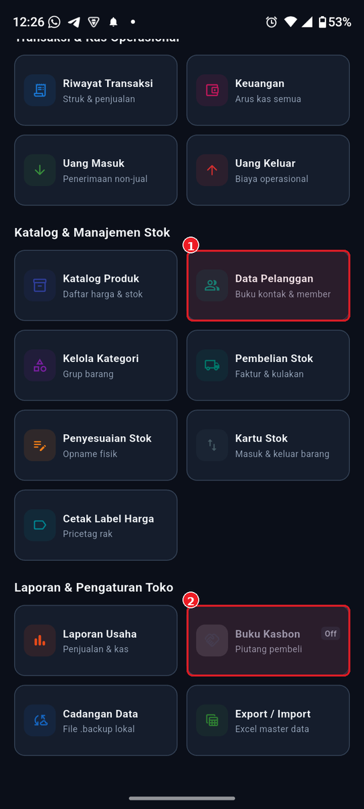
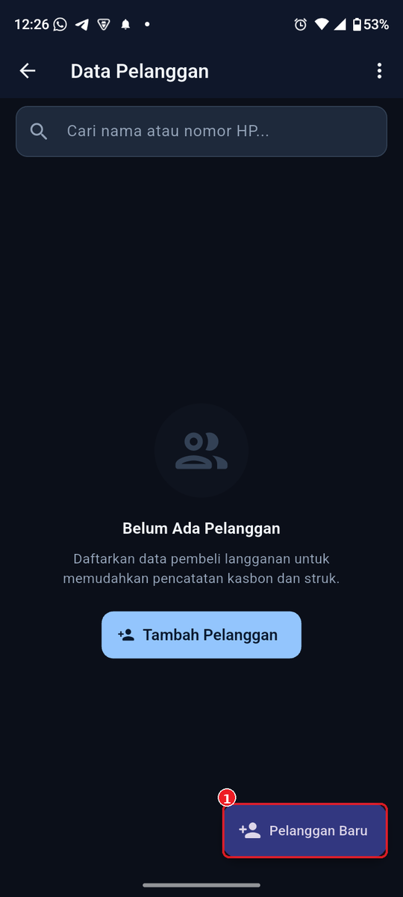
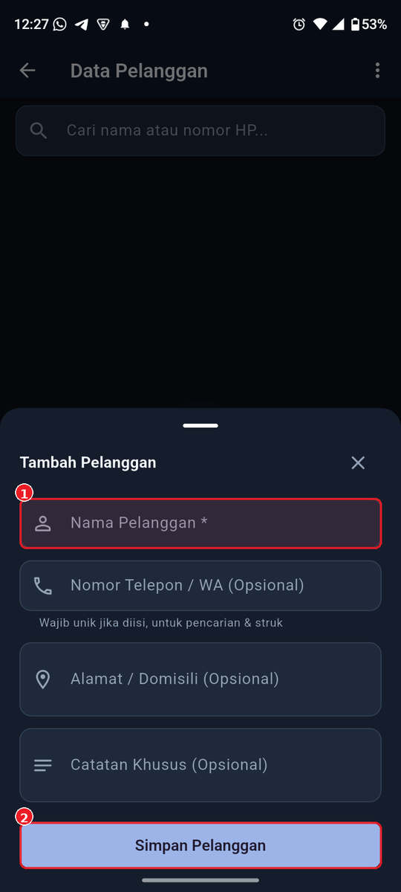
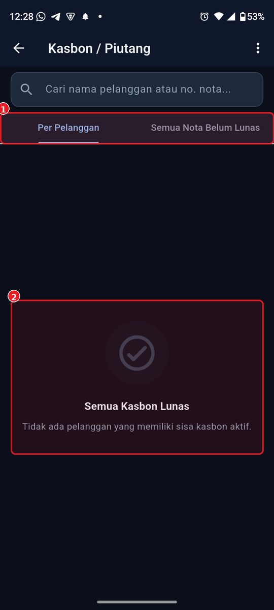

Dalam bisnis retail toko dan warung, mencatat pelanggan setia dan mengelola kasbon (piutang belanja) adalah kebutuhan nyata sehari-hari. **dotKasir** menyediakan modul **Data Pelanggan** untuk menyimpan kontak pembeli, serta fitur **Buku Kasbon** untuk melacak siapa saja yang memiliki tagihan belanja belum lunas tanpa takut catatan tercecer atau hilang.

Panduan ini membahas cara mendaftarkan kontak pelanggan baru, mengaktifkan fitur kasbon, dan memantau riwayat piutang pembeli.

---

## 1. Mengakses Menu Pelanggan & Kasbon di Beranda

Dari layar utama aplikasi **dotKasir**, Anda dapat menemukan dua kartu terkait:

1. **[1] Data Pelanggan**: Terletak pada seksi *Katalog & Manajemen Stok*. Digunakan untuk melihat daftar direktori pelanggan, mencari nomor telepon/WA, atau menambah member baru.
2. **[2] Buku Kasbon**: Terletak pada seksi *Laporan & Pengaturan Toko*. Digunakan untuk mengawasi total piutang toko, daftar nota belanja yang belum lunas, dan mencatat pelunasan bertahap.

> **Keterangan Penanda:**
> - **[1] Kartu Data Pelanggan**: Membuka direktori kontak dan profil pembeli.
> - **[2] Kartu Buku Kasbon**: Membuka lembar pembukuan piutang kasbon toko.

---

## 2. Melihat Daftar Pelanggan Toko

Saat membuka menu **Data Pelanggan**, Anda akan melihat halaman manajemen kontak:

1. **Pencarian Cepat**: Kolom pencarian di bagian atas memungkinkan Anda mencari pembeli berdasarkan nama atau nomor handphone.
2. **[1] Tombol Pelanggan Baru**: Tombol mengambang (*Floating Action Button*) di pojok kanan bawah untuk mendaftarkan pembeli baru ke database toko.

> **Keterangan Penanda:**
> - **[1] Tombol Pelanggan Baru**: Ketuk untuk membuka lembar formulir pendaftaran pelanggan.

---

## 3. Menambahkan Data Pelanggan Baru

Setelah menekan tombol **Pelanggan Baru**, sebuah formulir lembar bawah (*bottom sheet*) akan terbuka:

1. **[1] Nama Pelanggan \***: Masukkan nama lengkap atau panggilan pembeli (wajib diisi).
2. **Nomor Telepon / WA (Opsional)**: Masukkan nomor kontak WhatsApp aktif. Nomor ini memudahkan pencarian saat checkout di kasir serta pengiriman struk digital.
3. **Alamat / Domisili (Opsional)**: Catat alamat rumah atau toko pembeli jika melayani pengiriman pesanan (*delivery*).
4. **Catatan Khusus (Opsional)**: Catatan preferensi atau perjanjian khusus dengan pembeli.
5. Ketuk tombol **[2] Simpan Pelanggan** untuk menyimpan data ke database lokal.

> **Keterangan Penanda:**
> - **[1] Kolom Nama Pelanggan**: Masukkan identitas pelanggan pembeli.
> - **[2] Tombol Simpan Pelanggan**: Menyimpan kontak pelanggan ke perangkat.

---

## 4. Mengaktifkan & Memantau Buku Kasbon (Piutang)

Fitur Kasbon dirancang fleksibel: toko yang tidak menerapkan sistem utang piutang dapat menonaktifkannya, sementara toko yang membutuhkannya dapat mengaktifkannya dengan mudah:

### Mengaktifkan Fitur Kasbon
1. Buka menu **Pengaturan** (ikon gerigi di kanan atas beranda).
2. Gulir ke seksi **Fitur Tambahan**.
3. Aktifkan sakelar **Kasbon / Piutang Pelanggan**. Status kartu di beranda akan otomatis berubah menjadi aktif.

### Memantau Tagihan di Buku Kasbon
Buka kartu **Buku Kasbon** untuk melihat status piutang:
1. **[1] Tab Navigasi**:
   - **Per Pelanggan**: Mengelompokkan total piutang berdasarkan nama pembeli sehingga Anda tahu berapa total utang masing-masing orang.
   - **Semua Nota Belum Lunas**: Menampilkan daftar transaksi invoice spesifik yang pembayarannya belum diselesaikan.
2. **[2] Status Piutang Kasbon**: Menampilkan ringkasan tagihan aktif. Jika seluruh piutang telah lunas, sistem akan menampilkan indikator hijau centang **Semua Kasbon Lunas**.

> **Keterangan Penanda:**
> - **[1] Tab Per Pelanggan & Nota Belum Lunas**: Memilih sudut pandang pemantauan tagihan.
> - **[2] Indikator & Lembar Piutang**: Menampilkan status sisa kasbon dan riwayat pembayaran cicilan pelanggan.

---

## 5. Tips Mengelola Piutang Toko

- **Pilih Pelanggan Saat Kasir**: Saat pelanggan bertransaksi kasbon di meja kasir, selalu tautkan transaksi dengan nama pelanggan agar tagihan otomatis masuk ke Buku Kasbon atas nama orang tersebut.
- **Cicilan Bertahap**: dotKasir mendukung pencatatan pembayaran sebagian (angsuran/cicilan). Setiap kali pelanggan membayar cicilan, sisa tagihan akan berkurang dan dana masuk tercatat ke laporan kas.
- **Jatuh Tempo Wajar**: Buat kesepakatan batas waktu pelunasan (misal 7 atau 14 hari) agar perputaran modal usaha toko tetap sehat.
