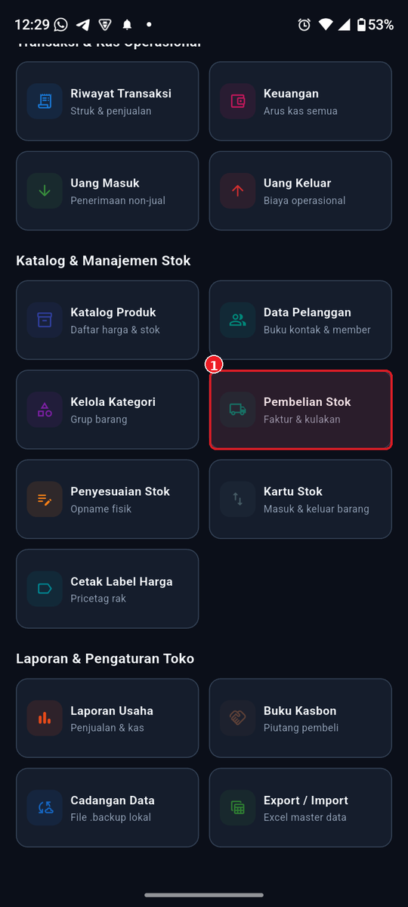
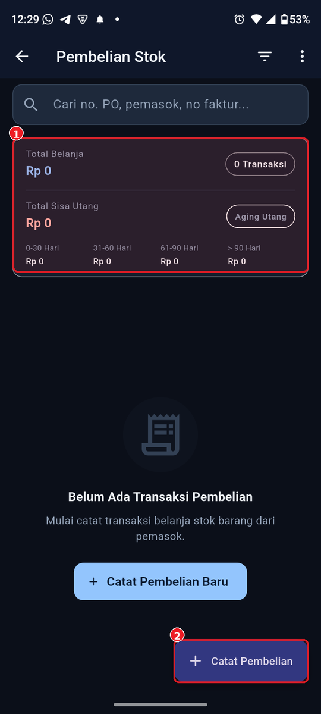
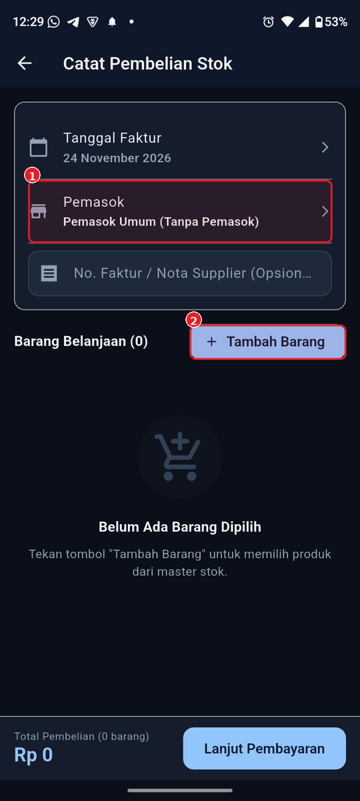
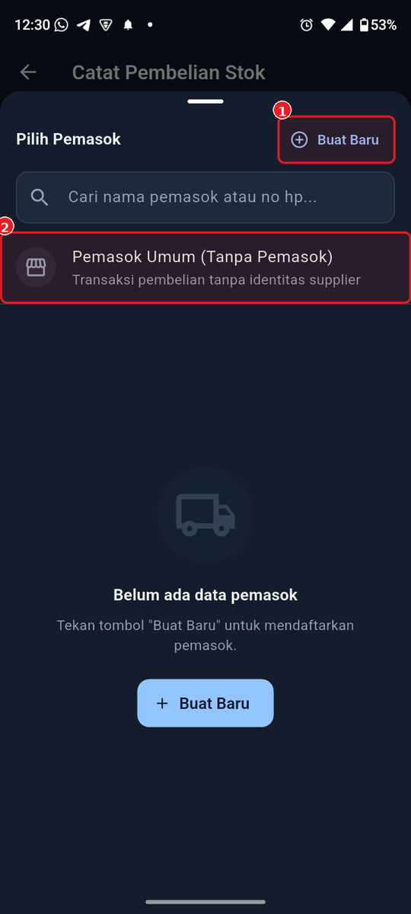

Menjaga ketersediaan barang dagangan di toko memerlukan pencatatan kulakan yang rapi dan terukur. Di **dotKasir**, setiap faktur belanja yang dicatat lewat modul **Pembelian Stok** tidak hanya menambahkan jumlah stok barang ke master katalog secara otomatis, tetapi juga dapat memantau utang tempo (*aging utang*) kepada pemasok (*supplier*).

Panduan ini membahas langkah demi langkah mengelola data supplier, mencatat faktur kulakan baru, serta memantau jadwal jatuh tempo utang dagang.

---

## 1. Mengakses Menu Pembelian Stok di Beranda

Modul Pembelian dapat diakses langsung dari menu utama:

1. Buka aplikasi **dotKasir**.
2. Pada seksi **Katalog & Manajemen Stok**, ketuk kartu **[1] Pembelian Stok** (ikon truk dengan subjudul *Faktur & kulakan*).

> **Keterangan Penanda:**
> - **[1] Kartu Pembelian Stok**: Pintu masuk ke riwayat faktur kulakan dan pemantauan utang dagang.

---

## 2. Memantau Riwayat Kulakan & Aging Utang

Saat membuka modul Pembelian, Anda akan disambut oleh ringkasan eksekutif transaksi kulakan:

1. **[1] Ringkasan Belanja & Aging Utang**:
   - **Total Belanja**: Akumulasi nilai belanja kulakan toko beserta jumlah transaksi.
   - **Total Sisa Utang**: Sisa kewajiban pembayaran tempo yang belum dilunasi kepada supplier.
   - **Aging Utang**: Pengelompokan umur utang (*0-30 Hari*, *31-60 Hari*, *61-90 Hari*, *> 90 Hari*) untuk mencegah keterlambatan pembayaran.
2. **[2] Tombol Catat Pembelian**: Tombol di pojok kanan bawah untuk memulai pembuatan faktur belanja baru.

> **Keterangan Penanda:**
> - **[1] Banner Total Belanja & Aging Utang**: Mengawasi arus belanja dan usia utang dagang.
> - **[2] Tombol Catat Pembelian**: Membuat faktur pembelanjaan stok baru.

---

## 3. Membuat Faktur Pembelian Stok Baru

Saat berada di layar formulir **Catat Pembelian Stok**:

1. **Tanggal Faktur**: Secara default terisi tanggal hari ini, ketuk jika ingin menyesuaikan dengan tanggal nota fisik.
2. **[1] Pemilihan Pemasok**: Ketuk untuk memilih pemasok barang (misal: *Pemasok Umum* atau nama distributor resmi).
3. **No. Faktur / Nota Supplier (Opsional)**: Ketikkan nomor invoice cetak dari distributor untuk mempermudah pencocokan arsip fisik.
4. **[2] Tombol Tambah Barang**: Ketuk untuk memilih produk dari katalog yang dibeli, mengisi kuantitas masuk, dan memperbarui harga beli (*HPP*).
5. Setelah produk ditambahkan, ketuk **Lanjut Pembayaran** untuk memilih metode pembayaran (Tunai atau Pembelian Tempo / Utang).

> **Keterangan Penanda:**
> - **[1] Baris Pilihan Pemasok**: Menghubungkan faktur belanja dengan identitas supplier.
> - **[2] Tombol Tambah Barang**: Memasukkan daftar produk kulakan beserta jumlah unit masuk.

---

## 4. Mengelola Data Supplier (Pemasok)

Ketika mengetuk baris Pemasok, lembar **Pilih Pemasok** akan muncul:

1. **[1] Tombol Buat Baru**: Ketuk untuk mendaftarkan mitra distributor atau supplier baru (isi nama supplier, nomor telepon sales/kantor, dan alamat distributor).
2. **[2] Pemasok Umum**: Opsi bawaan jika Anda membeli barang eceran di pasar atau grosir tanpa perlu mencatat profil supplier khusus.
3. Anda juga dapat mencari supplier yang sudah tersimpan menggunakan kolom pencarian di bagian atas lembar.

> **Keterangan Penanda:**
> - **[1] Tombol Buat Baru**: Mendaftarkan supplier baru ke sistem.
> - **[2] Pemasok Umum (Tanpa Pemasok)**: Pilihan praktis untuk belanja belanja harian tanpa supplier resmi.

---

## 5. Keuntungan Integrasi Stok Otomatis

- **Stok Bertambah Otomatis**: Segera setelah faktur disimpan, stok produk di katalog bertambah seketika tanpa perlu opname manual.
- **HPP Terupdate**: Harga beli baru pada faktur kulakan akan menjadi acuan dasar perhitungan estimasi laba kotor di modul Laporan Usaha.
- **Transparansi Kartu Stok**: Setiap faktur pembelian akan memunculkan mutasi masuk (+in) pada buku besar Kartu Stok dengan nomor referensi faktur yang jelas.
