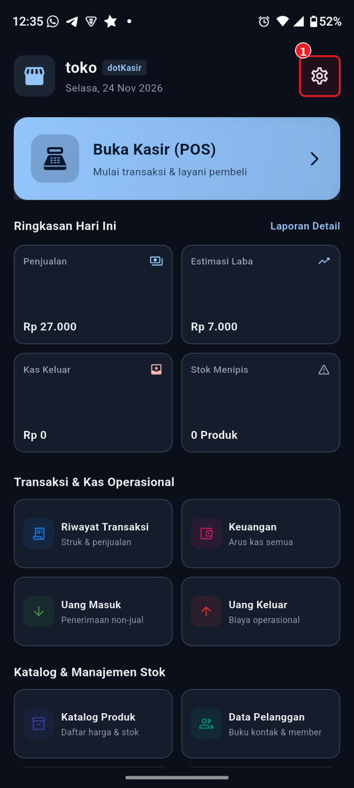
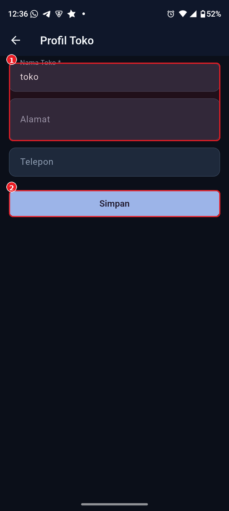
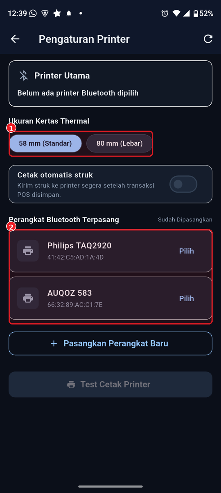
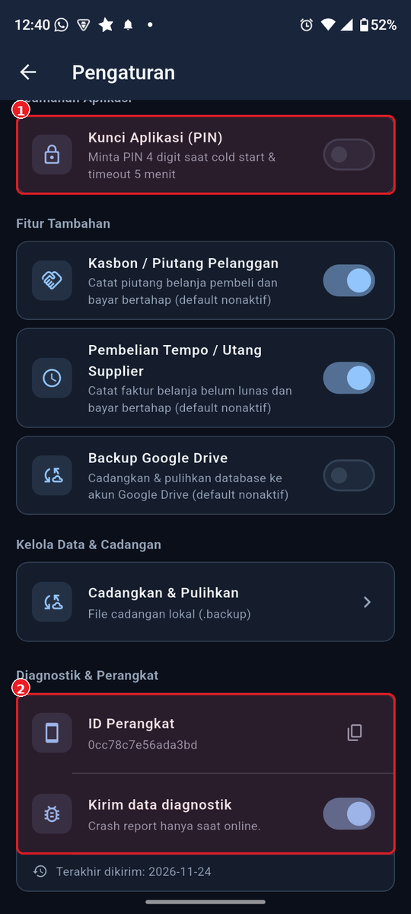

Menyesuaikan nama toko pada kop struk, memastikan printer thermal Bluetooth terhubung lancar, dan menjaga keamanan kasir dari akses yang tidak berwenang adalah konfigurasi awal paling penting sebelum mengoperasikan toko sehari-hari. Di **dotKasir**, semua kendali perangkat keras (*hardware*), profil bisnis, dan keamanan terpusat di menu **Pengaturan**.

Panduan ini membahas langkah demi langkah mengatur identitas toko, menyambungkan printer struk, dan mengaktifkan penguncian PIN kasir.

---

## 1. Mengakses Menu Pengaturan di Layar Utama

Layar pengaturan aplikasi dapat diakses kapan saja:

1. Buka aplikasi **dotKasir**.
2. Pada bagian paling atas beranda (di sebelah kanan nama toko), ketuk ikon roda gigi **[1] Pengaturan**.

> **Keterangan Penanda:**
> - **[1] Ikon Gerigi Pengaturan**: Pintu masuk utama ke seluruh konfigurasi sistem, printer, profil toko, dan keamanan.

---

## 2. Mengatur Profil & Informasi Toko (Kop Struk)

Informasi profil toko akan otomatis dicetak pada bagian kepala (*header*) setiap struk belanja pelanggan:

1. Dari menu Pengaturan, gulir ke seksi *Perangkat & Hardware* lalu pilih **Profil Toko**.
2. Pada kolom **[1] Nama Toko & Alamat**:
   - **Nama Toko \***: Masukkan nama toko atau merek usaha Anda (misal: *Toko Berkah Abadi*).
   - **Alamat**: Tuliskan alamat fisik toko atau lokasi outlet.
   - **Telepon**: Masukkan nomor handphone atau kontak WhatsApp pemesanan toko.
3. Ketuk tombol **[2] Simpan**. Seluruh cetakan struk kasir dan faktur pembelian berikutnya akan otomatis menggunakan kop nama toko terbaru.

> **Keterangan Penanda:**
> - **[1] Kolom Identitas Toko**: Input nama usaha, alamat, dan nomor kontak toko.
> - **[2] Tombol Simpan**: Memperbarui informasi profil toko ke sistem.

---

## 3. Menghubungkan Printer Thermal Bluetooth

dotKasir mendukung hampir semua merek printer thermal Bluetooth mini portabel (seperti Panda, VSC, Eppos, BellaV, Zjiang, dsb) tanpa perlu driver tambahan:

1. Pastikan Bluetooth di smartphone Anda aktif dan printer thermal dalam kondisi menyala (*ON*).
2. Di menu Pengaturan, ketuk opsi **Printer Thermal**.
3. **[1] Ukuran Kertas Thermal**:
   - Pilih **58 mm (Standar)** untuk printer thermal mini kasir saku portable yang paling umum.
   - Pilih **80 mm (Lebar)** untuk printer thermal desktop kasir berukuran sedang/besar.
4. **[2] Memilih Perangkat Bluetooth**:
   - Daftar perangkat yang sudah terpasang (*paired*) akan muncul di daftar. Ketuk tombol **Pilih** di samping nama printer Anda.
   - Jika belum pernah dipasangkan (*pair*), ketuk **+ Pasangkan Perangkat Baru** untuk memindai sinyal printer terdekat.
5. Ketuk tombol **Test Cetak Printer** di bagian bawah untuk memastikan teks tercetak rapi dan jelas di atas kertas thermal. Anda juga dapat mengaktifkan opsi **Cetak otomatis struk** agar struk langsung keluar begitu pembayaran berhasil.

> **Keterangan Penanda:**
> - **[1] Pilihan Lebar Kertas (58mm / 80mm)**: Menyesuaikan tata letak cetak dengan ukuran rol kertas printer.
> - **[2] Daftar Perangkat Bluetooth**: Menghubungkan printer kasir aktif.

---

## 4. Keamanan Aplikasi (Kunci Layar PIN 4 Digit)

Untuk toko yang mempekerjakan karyawan kasir bergantian atau menjaga perangkat kasir dari jangkauan anak-anak dan pihak luar:

1. Di menu Pengaturan, temukan seksi **Keamanan Aplikasi**.
2. **[1] Sakelar Kunci Aplikasi (PIN)**:
   - Aktifkan sakelar ini. Anda akan diminta menentukan 4 digit angka PIN rahasia.
   - Setelah aktif, dotKasir akan otomatis mengunci layar setiap kali aplikasi dibuka dari awal (*cold start*) atau setelah didiamkan selama 5 menit tanpa aktivitas kasir.
3. **[2] Diagnostik & Dukungan Teknis**:
   - Menampilkan nomor unik **ID Perangkat** kasir.
   - Ketuk ikon salin jika tim teknis bantuan dotKasir memerlukan identifikasi perangkat saat Anda berkonsultasi perbaikan sistem.

> **Keterangan Penanda:**
> - **[1] Kunci Aplikasi (PIN)**: Mengamankan akses kasir dengan proteksi sandi 4 digit.
> - **[2] ID Perangkat & Diagnostik**: Identitas teknis untuk verifikasi lisensi dan bantuan pengembang.
