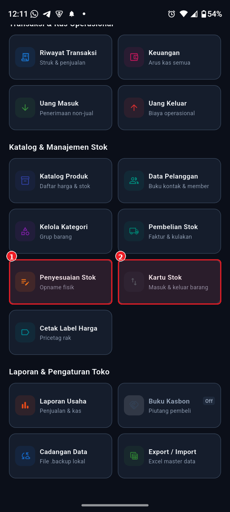
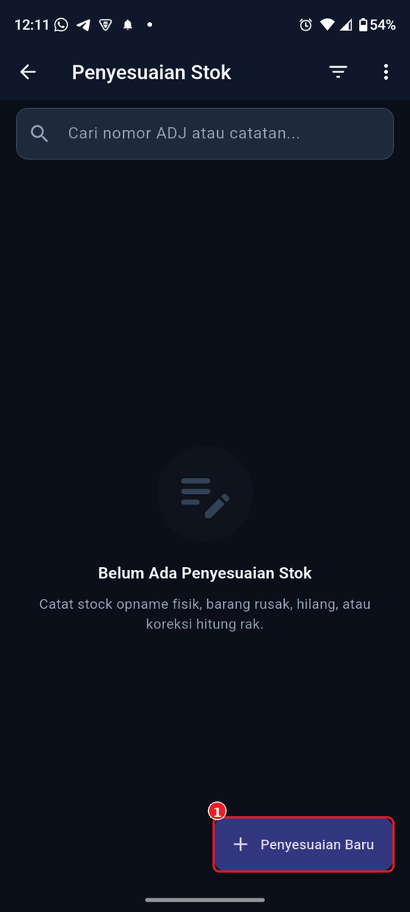
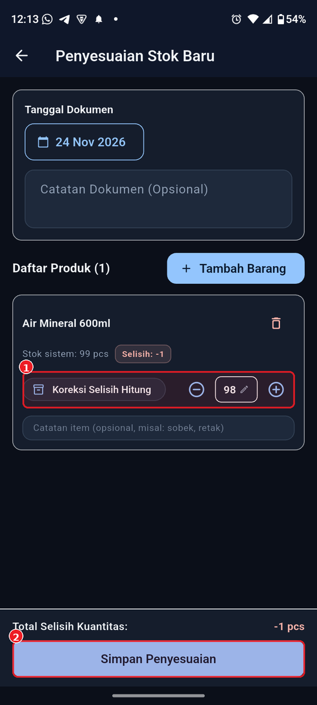
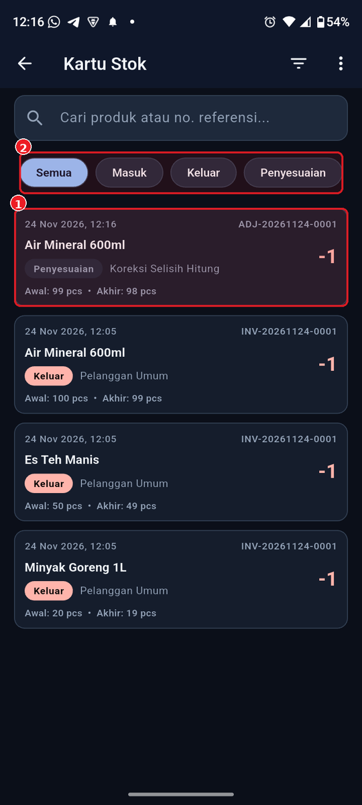

Dalam mengelola warung atau toko ritel, jumlah barang fisik di rak terkadang tidak sesuai dengan data di sistem kasir. Perbedaan ini bisa disebabkan oleh barang rusak, kedaluwarsa, terselip, atau kesalahan hitung saat kulakan.

**dotKasir** menyediakan dua fitur utama untuk menjaga akurasi persediaan toko:
1. **Penyesuaian Stok (*Stock Opname*)**: Untuk menyelaraskan jumlah barang di aplikasi agar sesuai dengan hitungan fisik nyata di rak.
2. **Kartu Stok**: Riwayat catatan mutasi lengkap yang mencatat setiap keluar-masuk barang (dari penjualan kasir, penerimaan kulakan, hingga penyesuaian manual).

---

## 1. Mengakses Menu Penyesuaian Stok & Kartu Stok

Kedua fitur persediaan ini dapat diakses langsung dari Dashboard Utama:

1. Buka aplikasi **dotKasir**.
2. Pada layar utama, gulir ke seksi **Katalog & Manajemen Stok**.
3. Anda akan menemukan dua menu berdampingan:
   - **[1] Penyesuaian Stok**: Untuk membuat dokumen opname atau koreksi stok fisik.
   - **[2] Kartu Stok**: Untuk memeriksa buku mutasi keluar-masuk barang dagangan.

> **Keterangan Penanda:**
> - **[1] Kartu Penyesuaian Stok**: Masuk ke riwayat dokumen opname fisik.
> - **[2] Kartu Kartu Stok**: Buka catatan aliran pergerakan barang.

---

## 2. Membuka Layar Daftar Penyesuaian Stok

Saat menu Penyesuaian Stok dibuka, Anda akan melihat riwayat dokumen audit persediaan yang pernah dibuat sebelumnya.

> **Fitur pada Layar Ini:**
> - **Kolom Pencarian**: Cari dokumen berdasarkan nomor referensi (*ADJ-xxx*) atau catatan alasan.
> - **Filter Status**: Menyaring riwayat opname berdasarkan rentang waktu.
> - **[1] Tombol + Penyesuaian Baru**: Tombol melayang di kanan bawah untuk memulai formulir audit stok baru.

---

## 3. Melakukan Stock Opname (Koreksi Stok Fisik)

Untuk mencocokkan stok fisik barang di toko:

1. Di layar daftar penyesuaian, ketuk tombol **[1] + Penyesuaian Baru**.
2. Di layar formulir, ketuk tombol **+ Tambah Barang** untuk memilih produk yang ingin di-opname dari katalog.
3. Setelah barang terpilih, sesuaikan jumlah fisik nyata:
   - Gunakan tombol **[+]** atau **[-]** untuk menaikkan/menurunkan kuantitas fisik. Anda juga dapat mengetuk angka untuk mengetik jumlah langsung.
   - Pilih alasan penyesuaian (misal: *Koreksi Selisih Hitung*, *Barang Rusak*, *Hilang*, atau *Kedaluwarsa*).
   - Tuliskan catatan opsional jika diperlukan (contoh: kemasan bocor di rak 2).
4. Periksa **Total Selisih Kuantitas** di bagian bawah (misalnya `-1 pcs`).
5. Ketuk tombol **[2] Simpan Penyesuaian**.
6. Dialog konfirmasi akan muncul. Ketuk **Ya, Simpan** untuk mengunci perubahan.

> **Keterangan Penanda:**
> - **[1] Koreksi Kuantitas & Alasan**: Baris barang menampilkan nama produk, stok sistem saat ini, kuantitas fisik hasil hitung, selisih (*difference*), dan pilihan alasan penyesuaian.
> - **[2] Tombol Simpan Penyesuaian**: Tombol konfirmasi untuk langsung memperbarui sisa stok barang di master katalog dan kasir.

> [!TIP]
> **Opname Multi-Produk Sekaligus**: Anda dapat menambahkan lebih dari satu produk dalam satu dokumen penyesuaian stok yang sama saat melakukan stock opname berkala (misal opname mingguan atau bulanan).

---

## 4. Memantau Aliran Barang di Kartu Stok

Setiap kali barang terjual di kasir, diterima dari pembelian supplier, atau dikoreksi melalui penyesuaian stok, sistem dotKasir otomatis mencatatnya ke dalam **Kartu Stok**.

1. Kembali ke layar utama, lalu ketuk kartu **[2] Kartu Stok**.
2. Anda akan melihat log buku mutasi lengkap secara kronologis (*terbaru di atas*).

> **Elemen Penting pada Kartu Stok:**
> - **[1] Kartu Mutasi Terbaru**:
>   - Waktu transaksi dan nomor dokumen (misal: `ADJ-20261124-0001` untuk penyesuaian, atau `INV-20261124-0001` untuk kasir).
>   - Nama produk yang bermutasi (misal: *Air Mineral 600ml*).
>   - Tipe mutasi (*Penyesuaian*, *Keluar*, atau *Masuk*).
>   - Jumlah kuantitas mutasi (warna merah `-1` untuk barang keluar/berkurang, warna hijau `+` untuk barang masuk).
>   - Kuantitas stok awal dan stok akhir (misal: *Awal: 99 pcs • Akhir: 98 pcs*).
> - **[2] Chip Filter Mutasi**:
>   - **Semua**: Menampilkan seluruh riwayat pergerakan stok.
>   - **Masuk**: Hanya menampilkan penambahan stok (kulakan/pembelian).
>   - **Keluar**: Hanya menampilkan penjualan kasir.
>   - **Penyesuaian**: Hanya menampilkan hasil audit opname fisik.

---

## 5. Tips Terbaik Mengelola Stok di Warung / Toko

1. **Jadwalkan Opname Rutin**: Lakukan stock opname singkat untuk produk-produk terlaris (*fast-moving*) setiap minggu agar selisih barang cepat terdeteksi.
2. **Audit Sebelum Kulakan**: Cek kartu stok produk sebelum memesan barang ke distributor untuk menghindari penumpukan barang yang perputarannya lambat.
3. **Cetak & Ekspor Excel**: Pada layar Kartu Stok, gunakan menu titik tiga di pojok kanan atas untuk mengekspor rekap mutasi ke file PDF atau Excel sebagai arsip pembukuan bulanan.
